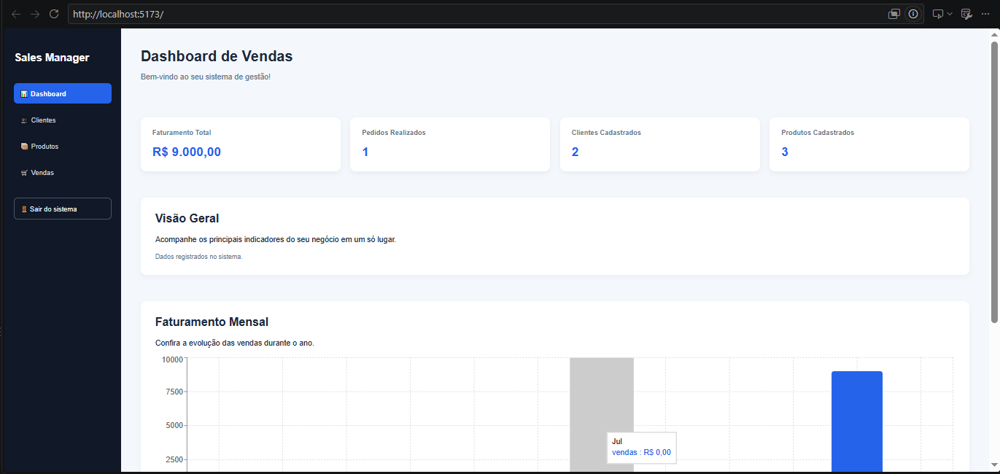
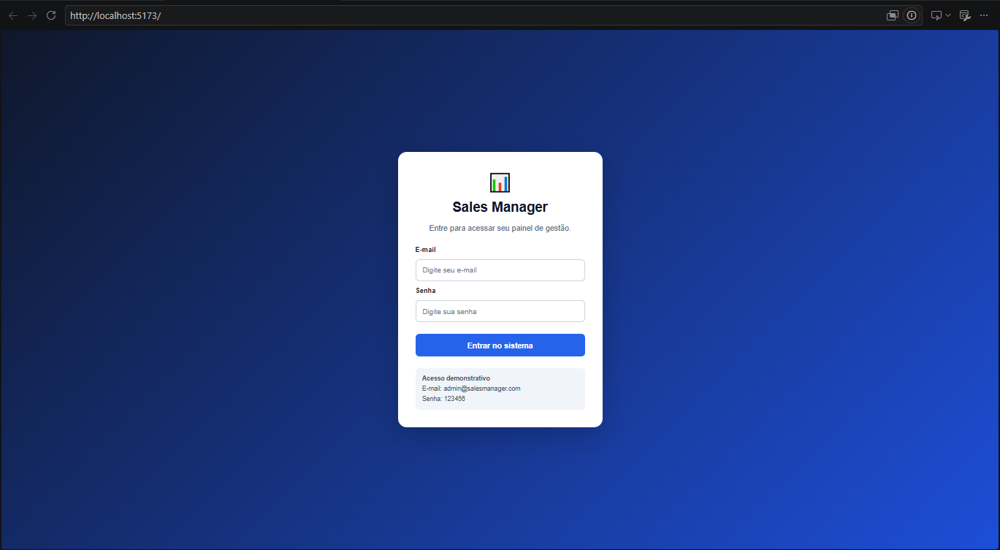

# Sales Manager

Sistema web de gerenciamento de vendas desenvolvido com React e TypeScript.

O projeto foi criado para praticar desenvolvimento front-end, organização de componentes, manipulação de dados e construção de interfaces para gestão comercial.

## Tecnologias utilizadas

- React — construção da interface e dos componentes
- TypeScript — tipagem e organização do código
- JavaScript — lógica e manipulação de dados
- HTML5 — estrutura da aplicação
- CSS3 — estilização e responsividade
- Vite — ambiente de desenvolvimento e build
- Recharts — gráficos de faturamento
- LocalStorage — armazenamento local de clientes, produtos e vendas
- SessionStorage — controle da sessão demonstrativa
- Git — versionamento do projeto
- GitHub — hospedagem do código-fonte
- VS Code — ambiente de desenvolvimento

## Funcionalidades

### Dashboard
- Indicadores de faturamento total
- Quantidade de pedidos realizados
- Total de clientes e produtos cadastrados
- Gráfico de faturamento mensal
- Visualização das vendas recentes

### Clientes
- Cadastro de clientes
- Edição e exclusão
- Pesquisa por nome ou e-mail

### Produtos
- Cadastro e edição de produtos
- Controle de quantidade em estoque
- Pesquisa por nome
- Identificação de estoque baixo e produtos esgotados

### Vendas
- Registro de vendas por cliente e produto
- Cálculo automático do valor total
- Validação da quantidade disponível
- Baixa automática no estoque
- Histórico e pesquisa de vendas

### Acesso
- Tela de login demonstrativo
- Navegação entre as áreas do sistema
- Opção de encerrar a sessão


## Demonstração

### Dashboard de Vendas



### Tela de Login




## Como executar o projeto

É necessário ter o Node.js instalado.

Clone o repositório:

```bash
git clone https://github.com/viniciuspsouza17/sales-management-dashboard.git
```

Acesse a pasta:

```bash
cd sales-management-dashboard
```

Instale as dependências:

```bash
npm install
```

Inicie o ambiente de desenvolvimento:

```bash
npm run dev
```

Abra o endereço informado pelo Vite no navegador.

## Acesso demonstrativo

E-mail: admin@salesmanager.com

Senha: 123456

As credenciais são exclusivamente para demonstração.

## Armazenamento de dados

Atualmente, o projeto utiliza LocalStorage para armazenar clientes, produtos e vendas no navegador.

O login é demonstrativo e não possui autenticação segura. A aplicação ainda não utiliza banco de dados ou backend.

Por isso, o sistema é destinado a estudos e demonstração, não ao armazenamento de informações comerciais reais.

## Próximas melhorias

- Integração com banco de dados
- Autenticação segura
- API para gerenciamento das informações
- Relatórios e filtros avançados
- Melhorias de desempenho e responsividade

## Autor

Vinicius Pereira de Souza

Projeto desenvolvido para estudo e composição de portfólio em desenvolvimento de sistemas.
